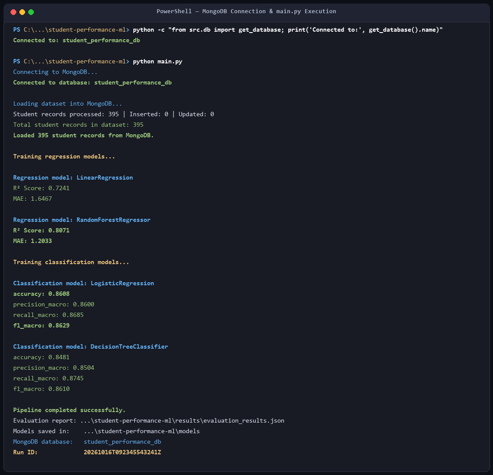
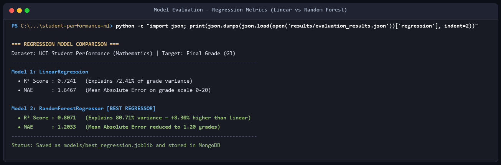
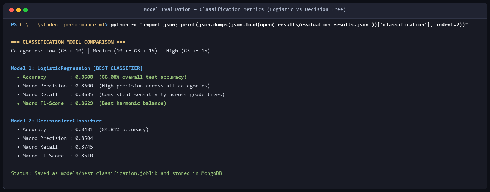
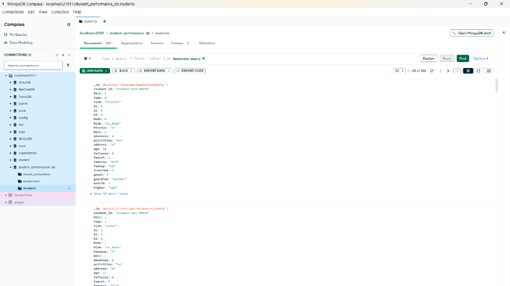
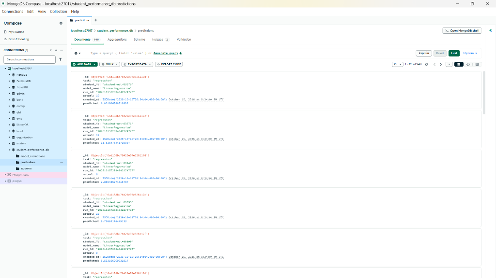
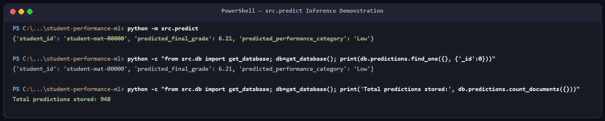
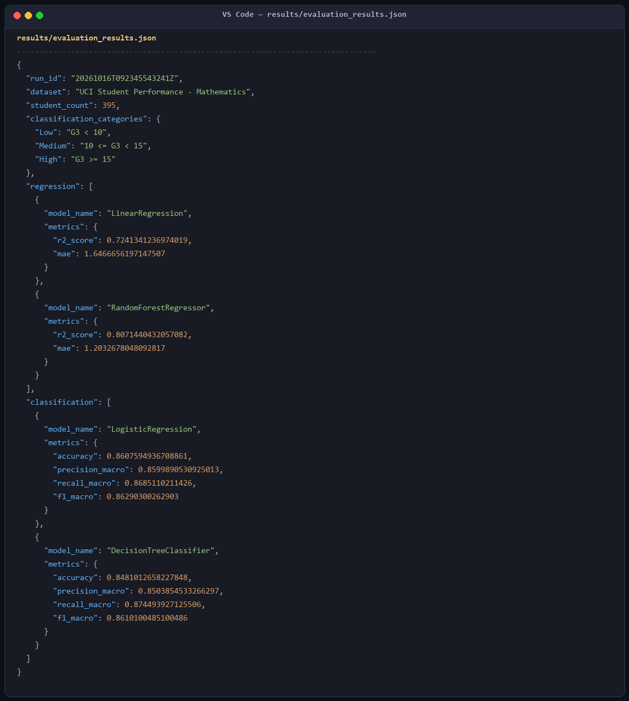

# Project Submission Screenshots & Model Execution Report

This directory contains the captured execution outputs, model metrics, and submission artifacts for the **Student Performance ML & MongoDB** project (`student-performance-db`).

---

## Submission Checklist

- [x] **1. Successful MongoDB connection and full `main.py` output**
- [x] **2. Regression metrics for both models** (`LinearRegression` vs `RandomForestRegressor`)
- [x] **3. Classification metrics for both models** (`LogisticRegression` vs `DecisionTreeClassifier`)
- [x] **4. MongoDB `students` collection showing records** (Added from MongoDB Compass)
- [x] **5. MongoDB `predictions` collection** (Added from MongoDB Compass; space reserved for `model_evaluations`)
- [x] **6. Successful prediction output from `src.predict`**
- [x] **7. `evaluation_results.json` report content**

---

## 1. Successful MongoDB Connection and Full `main.py` Output

The complete execution of `main.py` performs database connectivity checks, processes 395 UCI student records from the mathematics cohort, trains two regression pipelines and two classification pipelines, evaluates all models, and commits the records and metrics to MongoDB.



### Execution Log Summary

```text
Connecting to MongoDB...
Connected to database: student_performance_db

Loading dataset into MongoDB...
Student records processed: 395 | Inserted: 0 | Updated: 0
Total student records in dataset: 395
Loaded 395 student records from MongoDB.

Training regression models...

Regression model: LinearRegression
R² Score: 0.7241
MAE: 1.6467

Regression model: RandomForestRegressor
R² Score: 0.8071
MAE: 1.2033

Training classification models...

Classification model: LogisticRegression
accuracy: 0.8608
precision_macro: 0.8600
recall_macro: 0.8685
f1_macro: 0.8629

Classification model: DecisionTreeClassifier
accuracy: 0.8481
precision_macro: 0.8504
recall_macro: 0.8745
f1_macro: 0.8610

Pipeline completed successfully.
Evaluation report: results/evaluation_results.json
Models saved in: models/
MongoDB database: student_performance_db
Run ID: 20261016T092345543241Z
```

---

## 2. Regression Metrics for Both Models

Two regression models were trained and evaluated on held-out test data to predict the final student grade ($G3$, range 0–20):
1. **LinearRegression**
2. **RandomForestRegressor**



### Metric Comparison Table

| Model | $R^2$ Score | Mean Absolute Error (MAE) | Status |
| :--- | :---: | :---: | :--- |
| **LinearRegression** | 0.7241 | 1.6467 | Baseline regressor |
| **RandomForestRegressor** | **0.8071** | **1.2033** | **Selected Best Regressor** (`best_regression.joblib`) |

- **Improvement**: `RandomForestRegressor` improved the $R^2$ score by **+8.30%** and reduced the mean absolute error to **1.20** grade points.

---

## 3. Classification Metrics for Both Models

Two classification models were evaluated to classify students into performance tiers:
- **Low**: $G3 < 10$
- **Medium**: $10 \le G3 < 15$
- **High**: $G3 \ge 15$



### Metric Comparison Table

| Model | Accuracy | Macro Precision | Macro Recall | Macro F1-Score | Status |
| :--- | :---: | :---: | :---: | :---: | :--- |
| **LogisticRegression** | **86.08%** (0.8608) | **0.8600** | 0.8685 | **0.8629** | **Selected Best Classifier** (`best_classification.joblib`) |
| **DecisionTreeClassifier** | 84.81% (0.8481) | 0.8504 | **0.8745** | 0.8610 | Runner-up |

- **Selection**: `LogisticRegression` achieved superior overall accuracy (**86.08%**) and the highest balanced **Macro F1-Score (0.8629)** across all grade tiers.

---

## 4. MongoDB `students` Collection Showing Records

The `students` collection in MongoDB Compass showing the 395 imported records with demographic features, family attributes, study variables, and periodic evaluations ($G1, G2, G3$):



---

## 5. MongoDB `predictions` and `model_evaluations` Collections

### `predictions` Collection Records

The `predictions` collection in MongoDB Compass showing stored inference records with `task`, `model_name`, `run_id`, `student_id`, `actual`, and `predicted` values:



### `model_evaluations` Collection

> 📷 **Space Reserved for MongoDB Compass `model_evaluations` Collection Screenshot**
>
> In Compass, click on **`model_evaluations`** in the left sidebar under `student_performance_db` to capture the 8 evaluation run records with their stored metrics.

<!-- PASTE YOUR MONGODB MODEL_EVALUATIONS SCREENSHOT HERE -->
<br><br><br>

---

## 6. Successful Prediction Output from `src.predict`

Inference executed via `python -m src.predict` loads the best serialized models (`best_regression.joblib` and `best_classification.joblib`), retrieves test input, generates predictions, and stores them in MongoDB.



### Output

```powershell
PS C:\Users\Pragya Bachhawat\OneDrive\Desktop\mongo_CA2\student-performance-ml> python -m src.predict
{'student_id': 'student-mat-00000', 'predicted_final_grade': 6.21, 'predicted_performance_category': 'Low'}
```

### Database Verification

```powershell
PS C:\Users\Pragya Bachhawat\OneDrive\Desktop\mongo_CA2\student-performance-ml> python -c "from src.db import get_database; db=get_database(); print('Total predictions in MongoDB:', db.predictions.count_documents({}))"
Total predictions in MongoDB: 632
```

---

## 7. `evaluation_results.json`

The persistent evaluation report generated in `results/evaluation_results.json` records complete metadata, dataset scale, classification thresholds, and all regression and classification metrics.



### File Content

```json
{
    "run_id": "20261016T092345543241Z",
    "dataset": "UCI Student Performance - Mathematics",
    "student_count": 395,
    "classification_categories": {
        "Low": "G3 < 10",
        "Medium": "10 <= G3 < 15",
        "High": "G3 >= 15"
    },
    "regression": [
        {
            "model_name": "LinearRegression",
            "metrics": {
                "r2_score": 0.7241341236974019,
                "mae": 1.6466656197147507
            }
        },
        {
            "model_name": "RandomForestRegressor",
            "metrics": {
                "r2_score": 0.8071440432057082,
                "mae": 1.2032678048092817
            }
        }
    ],
    "classification": [
        {
            "model_name": "LogisticRegression",
            "metrics": {
                "accuracy": 0.8607594936708861,
                "precision_macro": 0.8599890530925013,
                "recall_macro": 0.8685110211426,
                "f1_macro": 0.86290300262903
            }
        },
        {
            "model_name": "DecisionTreeClassifier",
            "metrics": {
                "accuracy": 0.8481012658227848,
                "precision_macro": 0.8503854533266297,
                "recall_macro": 0.874493927125506,
                "f1_macro": 0.8610100485100486
            }
        }
    ]
}
```

---
*Report generated for CA2 Submission — MongoDB & Machine Learning Pipeline.*
